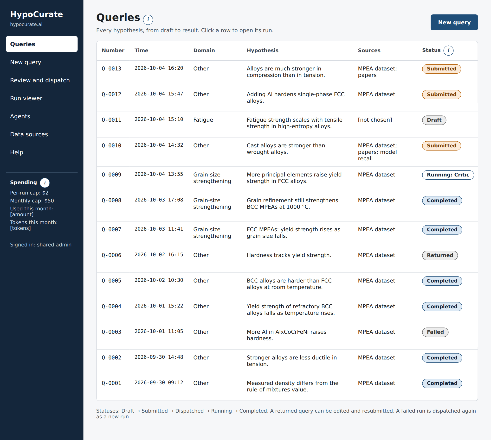
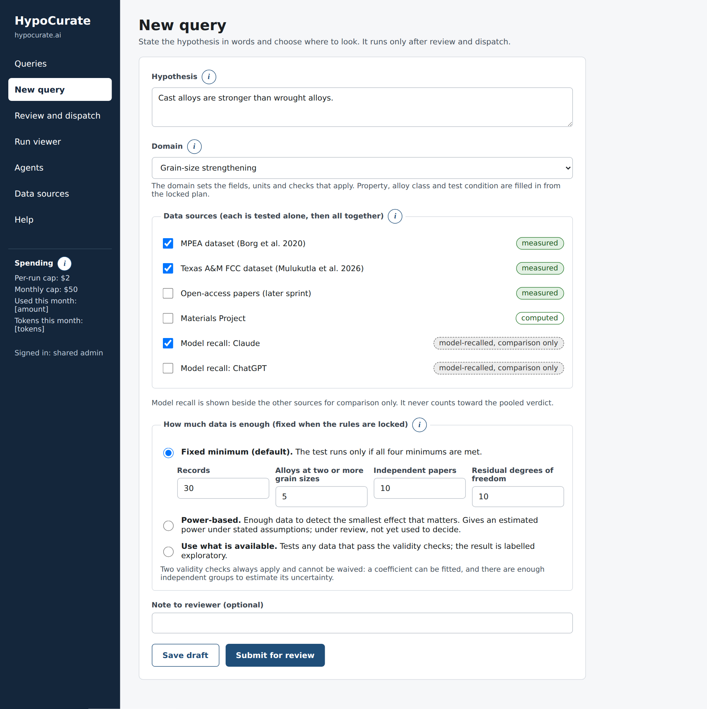
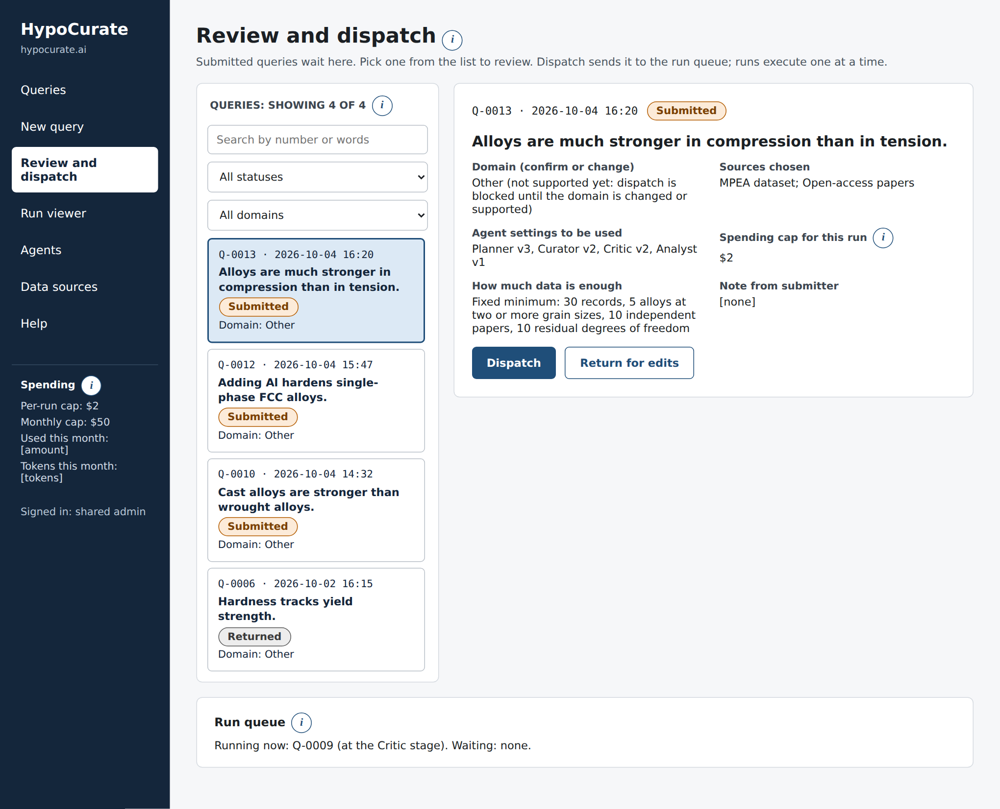
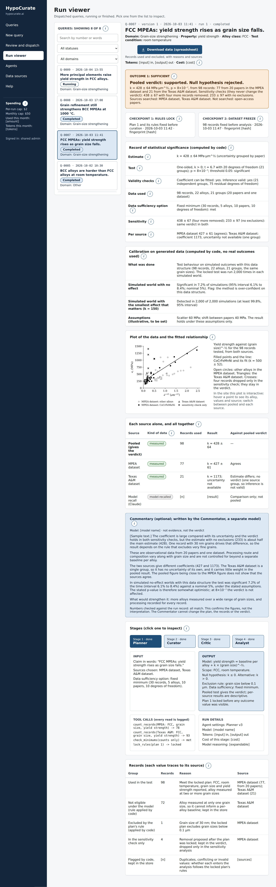
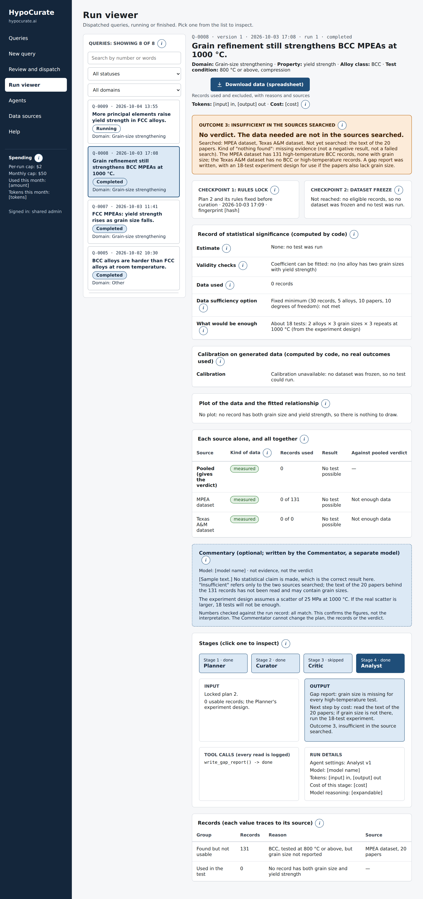
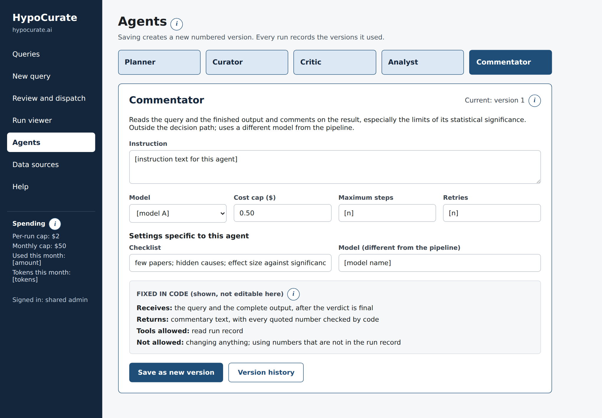
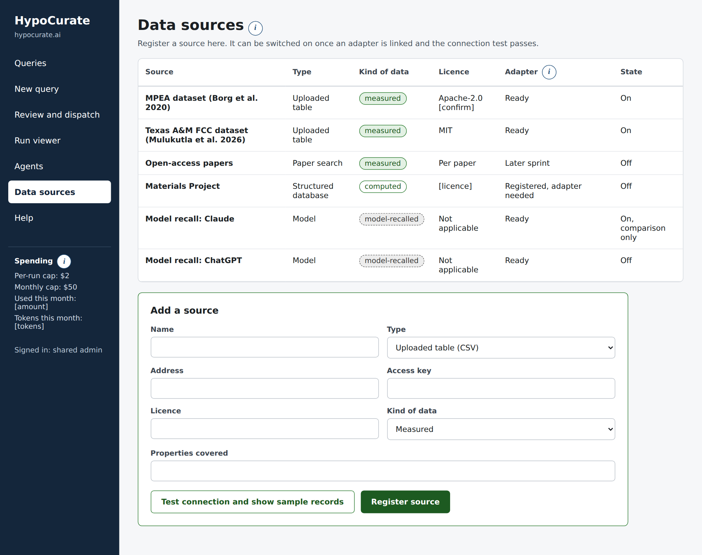
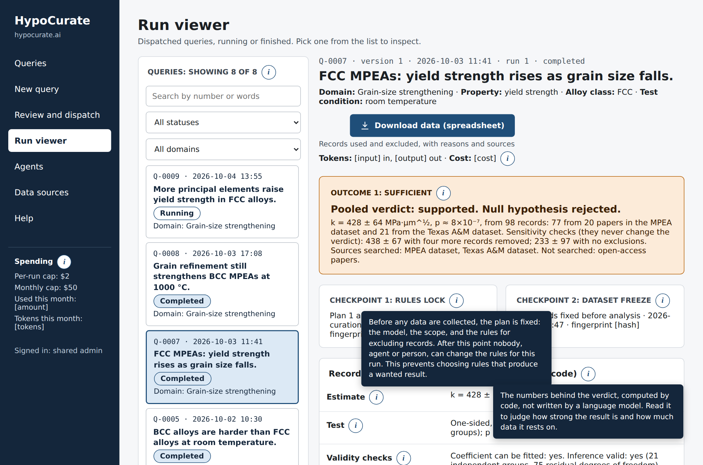
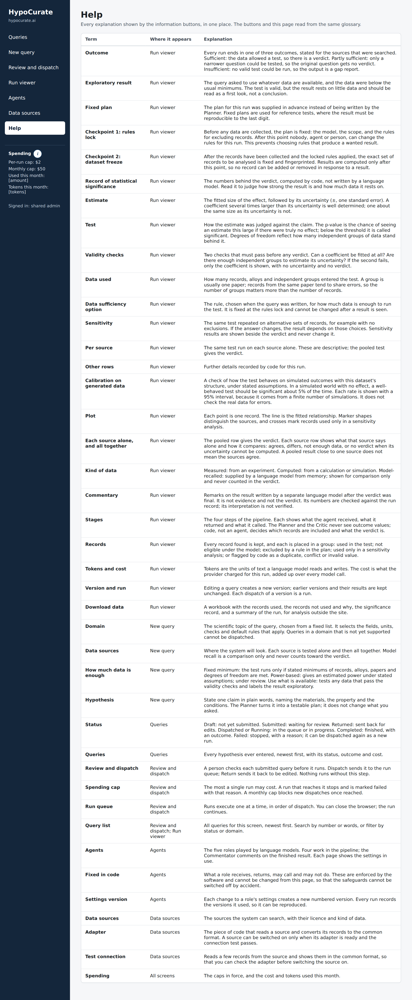

# HypoCurate — Sprint 1 Product Requirements Document (v1.6, Markdown copy)

This is a Markdown copy of `HypoCurate_Sprint1_PRD_2026-10-04_v1.6` for use in the repository. Screens are in `docs/mockup_screens/`; explanation texts are in `docs/glossary.json`.

| **Item** | **Value** |
|---|---|
| Version | 1.6, 4 October 2026 |
| Changes in 1.6 | Calibration tightened: software correctness separated from statistical calibration; an interval on every simulated rate; narrower wording; calibration skipped when inference cannot run (Sections 5.10, 7, 13.3, 14.5). Explanation popups on every screen and a Help page, from one glossary (Sections 9.7, 14.5, 15, Appendix A). |
| Changes in 1.5 | Generated test data with known answers: a fixed set in the regression suite and a calibration check on every real run (Sections 5.10, 7, 9.4, 11, 13.3, 14.5, 15). A backlog of everything deferred to later sprints (Section 18). |
| Changes in 1.4 | Statistical rules corrected: two validity checks that cannot be waived; fixed minimums as the default data-sufficiency option; the power-based option renamed and not used as a gate; the reference distribution stated; the Texas A&M per-source result corrected; acceptance 14.1 split into a fixed-plan reference test and a live test; the Commentator made optional until the core tests pass (Sections 5.7, 5.8, 5.9, 9, 10, 13, 14, 15, 17). |
| Changes in 1.3 | Two checkpoints (rules lock, dataset freeze); one fully specified statistical model, with code deciding sufficiency and the verdict; data sufficiency as a query parameter; access tested on a role's complete input; the second source chosen and inspected; a record of statistical significance and a commentary by a fifth role, the Commentator (Sections 3, 4, 5.6 to 5.9, 6, 7, 8, 9, 10, 11, 13, 14, 15, 17). |
| Changes in 1.2 | Tokens and actual cost tracked for every query; agents behind a common interface with the mode recorded on each run; a regression test suite built as we go; independent review by a second model (Sections 6, 7, 8, 9, 11, 13, 14, 15, 16). |
| Changes in 1.1 | Domain and tags for every query (Sections 5.5, 7, 9, 11, 14). |
| Owner | Khalid A. El-Awady |
| Built with | Claude Code and Visual Studio Code |
| Source of requirements | HypoCurate Combined Overview, draft v3.13 (4 October 2026) |
| Mockup | HypoCurate Site Mockup (clickable, private): https://claude.ai/artifact/RH1FwupTezjhcmr7yQSoM7 |
| Status | Draft for review. Open decisions are listed in Section 17. |

# 1. Purpose of the sprint

HypoCurate takes a hypothesis about metal alloys stated in words, turns it into a statistical test that is locked before any result is seen, searches data sources for the data that test needs, and then reports one of three outcomes for the sources it searched: the data are **sufficient** (a verdict and a curated dataset), **partly sufficient** (no verdict on the original question; a narrower question tested separately; a gap report), or **insufficient** (a gap report, and an experiment design once cheaper sources are exhausted).

Sprint 1 builds the pipeline and the website together, pipeline first. It must demonstrate the safeguards the project is about, on one real claim and two real sources. The result serves two purposes: a working prototype for the CS329Z class project, and preliminary evidence for a planned research proposal.

The sprint is done when the four acceptance criteria in Section 14 pass. Those criteria are about curation behaviour, not about screens.

# 2. Scope

## 2.1 In scope

- The pipeline with four agent roles (Planner, Curator, Critic, Analyst) and the deterministic code around them, running inside one background worker, plus a fifth role, the Commentator, which comments on the finished result (Section 5.9). The Commentator is optional until the core acceptance tests pass.

- Two checkpoints: the rules lock before curation and the dataset freeze before analysis (Section 5.6).

- One supported statistical model, with code deciding sufficiency and the verdict (Section 5.7), and data sufficiency as a parameter of the query (Section 5.8).

- The access contract in Section 4, enforced in code and tested.

- The locked plan, including exclusion rules and analysis eligibility rules (Section 5).

- Two structured data sources, the MPEA dataset and the Texas A&M FCC dataset (Section 10), with every record tagged by source.

- The test run on the pooled data (the verdict) and on each source alone (descriptive).

- The three outcomes, the three kinds of "nothing found", and the rule that a narrower question is a separate record.

- A domain and tags (property, alloy class, test condition) recorded for every query (Section 5.5).

- Tokens consumed and actual cost recorded for every model call and totalled per stage, run, query and month (Section 8).

- A regression test suite that grows with the code, and independent review by a second model after significant changes (Section 13).

- An information button with a short explanation beside every heading on every screen, and a Help page, both fed by one glossary (Section 9.7 and Appendix A).

- A generator of test data with known answers, used as a fixed set in the regression suite and as a calibration check on every real run (Sections 5.10 and 13.3).

- The website: login, queries list, new query, review and dispatch, run viewer with plot and spreadsheet download, data sources, and read-only agent pages.

- A command-line entry point that runs the same pipeline.

- Containers for every service, a GitHub repository, and deployment on Render.

## 2.2 Out of scope for sprint 1 (deferred)

The full list of deferred items, for planning the next sprint, is the backlog in Section 18.

- Reading papers and figures (data tiers B and C). The design must not block it: the Curator extraction and code inclusion split is built now.

- Editing agent settings in the browser. Sprint 1 shows the settings read-only; they are changed in code and versioned.

- MCP servers. Data access is plain Python functions in sprint 1 and is wrapped as MCP servers after an end-to-end run works.

- Generating experiment designs with an agent. Sprint 1 produces the gap report; the experiment design section of the report is a placeholder.

- Separate user accounts, chat about a run, re-running from a stage, parallel runs, and the benchmark batches.

- The single-agent version of the pipeline, used later to compare four agents with one. Sprint 1 builds only the interface that lets it be plugged in (Section 6).

- Fatigue and other domains. Sprint 1 covers grain-size strengthening only.

# 3. How a query flows

1.  **Draft and submit.** A person writes a hypothesis in words, picks its domain, chooses data sources and chooses how much data is enough (Section 5.8). Editing a hypothesis creates a new version; it never changes a run that has been made.

2.  **Review and dispatch.** A person reviews the submitted query, confirms or changes its domain, and dispatches it or returns it for edits. Dispatch creates a run and puts it in the queue.

3.  **Planner (agent).** Fills in the parameters of the supported model: variables, scope, exclusion rules from the allowed menu, and the tags. It sees record counts only.

4.  **Checkpoint 1: rules lock.** The plan and its rules are fixed and fingerprinted, before any curation.

5.  **Curator (agent) and inclusion (code).** The Curator maps each source to the fixed list of fields and extracts every matching record. Code then applies the locked rules to decide which records are eligible.

6.  **Checks (code) and Critic (agent).** Code compares values and raises flags. The Critic classifies each flag from sources and metadata; it is told the kind of flag, not the numbers.

7.  **Checkpoint 2: dataset freeze.** The analysis dataset is fixed and fingerprinted, before any analysis. Code decides from the predictor values whether the data are sufficient.

8.  **Statistics (code) and Analyst (agent).** Code runs the locked test on the pooled data and on each source, runs the sensitivity analyses, and determines the verdict. The Analyst explains the result and writes the report or the gap report.

9.  **Commentator (agent).** After the verdict is final, a separate model reads the query and the complete output and writes a commentary on the result and the limits of its statistical significance. It cannot change anything.

10. **Result.** The run viewer shows the outcome, the two checkpoints, the record of statistical significance, the plot, the per-source table, the commentary, each stage's input and output, and the records used and excluded. The data can be downloaded as a spreadsheet.

## 3.1 The three outcomes

| **Outcome** | **What the system returns** |
|---|---|
| Sufficient | A verdict from the pooled test, per-source results, sensitivity analyses and a curated dataset. |
| Partly sufficient | No verdict on the original question. A narrower question is stored as a separate, labelled record linked to the original, with its own locked plan and verdict. A gap report says what is missing for the original. |
| Insufficient in the sources searched | No verdict. A gap report listing missing fields, the shortfall against the required sample size, the sources searched and not searched, and the kind of "nothing found". |

Every result lists the sources searched and the sources not searched. A field missing from one dataset shows a gap in that dataset, not that the measurement was never made.

The three kinds of "nothing found" are: a **reported negative result** (the measurement was made and showed no effect), **missing evidence** (no one has reported the measurement in the sources searched), and a **failed search** (the system could not reach or read a source).

# 4. Access contract

What each role can see is fixed in code, by role and by stage. There is no general unlock at either checkpoint. Roles that can add or remove records never see outcome values. Every read goes through the data-access layer and is written to an audit log.

| **Role** | **Can see** | **Cannot do or see** |
|---|---|---|
| Planner (agent) | The claim in words; record counts by field | Outcome values, at any stage |
| Curator, extraction (agent) | The source it is reading; the list of fields to extract | The direction of the claim; any say over which records are included |
| Inclusion (code) | The locked rules; record fields | Discretion: rules are applied exactly as written |
| Checks (code) | All values | Judgment: it only raises flags |
| Critic (agent) | Sources, metadata, and the kind of each flag raised by code | Outcome values, including the numbers behind a flag; choosing between conflicting values |
| Analyst (agent) | Results and outcome values, after the dataset freeze | Changing the plan, the records, or the verdict that code computed |
| Commentator (agent) | The query and the complete output, after the verdict is final | Changing anything; using numbers that are not in the run record |

**Allowed fields, not blocked fields.** Each role has a written list of the fields it may receive, kept in code next to the access layer. Anything not on the list is withheld. Removing the outcome column alone is not enough: outcome values can also leak through the numbers stored with a flag, through values as originally reported, through nested fields, and through explanatory text passed between stages.

**Implementation requirement.** Each agent role receives a data-access object built for that role and stage. A call that the role is not allowed to make raises an AccessDenied error and writes a row to the audit log. A flag passed to the Critic carries its kind, the record identifiers, the metadata and a category (for example "differ beyond tolerance" or "identical values"), never the numbers compared. The contract can be relaxed only by an explicit experiment flag on the run, which is recorded and shown in the run viewer.

**Testing requirement.** Access is tested on everything a role receives: the prompt text, every tool response and any text handed over from an earlier stage. The test data contain distinctive planted outcome values, and the tests fail if any of them appears anywhere in the input of the Planner or the Critic.

# 5. The plan and its two checkpoints

## 5.1 What the plan contains

- The claim in words, and the version of the hypothesis it belongs to.

- Variables with units, including the outcome variable and the predictor.

- Scope: alloy class, temperature range, test type, and any other condition.

- The parameters of the supported statistical model (Section 5.7): hypotheses and significance threshold.

- The data-sufficiency option and its values (Section 5.8).

- The list of fields the Curator must extract.

- Exclusion rules (Section 5.2) and analysis eligibility rules (Section 5.3).

- The statement that the pooled test gives the verdict and that per-source results are descriptive.

- The sensitivity analyses that will be run.

The rules lock stores the plan with a fingerprint and a timestamp. After it, no agent and no person can change the plan for that run. A change means a new hypothesis version and a new run. Section 5.6 describes the two checkpoints.

## 5.2 Exclusion rules

Removing records after seeing the outcome is a way to search for a result, so it is closed off. Exclusion rules are chosen by the Planner from an allowed menu before the rules lock and applied by code. The menu in sprint 1: a grain-size range, a temperature range, phase, and test type. Example for the sprint claim: exclude records with grain size below 0.1 µm.

Any removal proposed after the lock, by an agent or a person, goes into a separate, labelled sensitivity analysis. It is reported beside the verdict and never changes it.

## 5.3 Conflicting, duplicate and invalid records: stored is not the same as analysed

All observations are kept in the evidence store with their sources. Nothing is deleted or overwritten, and the Critic never chooses a preferred value. Keeping a record does not mean it is pooled into the analysis. Whether a flagged record enters the analysis is decided by eligibility rules that are part of the locked plan and applied by code. The defaults below apply unless the Planner sets a different rule before the lock; the rule used is stored with the run.

| **Class of flagged record** | **Kept in the store** | **Enters the primary analysis (default rule)** | **Sensitivity analysis** |
|---|---|---|---|
| Exact duplicate: the same measurement reported by two sources | Yes, both | Counted once. Code keeps the record from the original paper, or the first source in a fixed order if the origin is unknown. | None |
| Possible duplicate that cannot be resolved | Yes, both | Counted once, by the same fixed rule, so that one measurement is not counted twice. | Both counted separately |
| Comparable specimens and conditions; the values truly differ | Yes, both | Both enter, with records grouped by paper in the model. | None |
| Incompatible measurements: outside the plan's scope (test type, temperature, condition) | Yes | No. Listed as out of scope. | None |
| Difference explained by missing metadata: scope cannot be confirmed | Yes | No. Listed as "scope not confirmed". | Included |
| Invalid value: physically impossible (for example tensile strength below yield strength, or a negative grain size) | Yes, flagged | No. | None |
| Model-recalled value (from a language model's memory) | Kept apart, never in the evidence base | Never. | Shown beside the sources for comparison only |

**When two records are the same measurement.** Two records count as duplicates only if they come from the same original paper and match on alloy, grain size, value and test conditions. Matching alloy and grain size alone is not enough.

Physical checks must not involve the relationship under test. Agreement with the expected grain-size relationship can never be used to decide which records are credible.

## 5.4 A narrower question is a different question

When only part of a claim can be tested, the Planner may propose a narrower question (for example, one alloy class instead of all). The narrowing is decided on record counts, never on outcomes. The original question keeps the status "partly sufficient" and receives no verdict. The narrower question is stored as its own record, linked to the original, with its own locked plan and verdict, and is labelled as narrower wherever it appears.

## 5.5 Domain and tags

Every query carries a domain and three tags. They organize the testability-gap map, select the rules that apply, and let queries be filtered and reported by topic.

| **Field** | **Meaning and values** | **Who sets it** | **When** |
|---|---|---|---|
| Domain | The scientific topic. A fixed list, not free text: "Grain-size strengthening" (supported in sprint 1), "Fatigue" and "Other" (listed, not yet supported). | The submitter picks it; the reviewer confirms or changes it | Before dispatch |
| Property | The outcome variable of the plan, for example yield strength or hardness. | The Planner, from the plan | At the lock |
| Alloy class | For example FCC, BCC refractory, or conventional alloys. More than one value is allowed. | The Planner, from the plan | At the lock |
| Test condition | Temperature band and test type, for example room temperature, tension. | The Planner, from the plan | At the lock |

- **Domain profile.** Each domain has a profile in code: the fields to extract, the units, the physical checks, and the default exclusion and eligibility rules. Sprint 1 has one profile, for grain-size strengthening. Adding a domain later means adding a profile, not changing the pipeline.

- **Unsupported domains.** A query in a domain without a profile can be drafted and submitted, but dispatch is blocked with a clear message.

- **Mismatch.** If the Planner judges that the claim belongs to a different domain than the one chosen, the run stops before the lock with the status "failed: domain mismatch" and a note for the reviewer.

- **Tags are values from fixed lists** kept in the database, so that the same thing is always named the same way. The Planner chooses from the lists and may propose a new value, which a person must approve.

- **A narrower question** inherits the domain of its original and gets its own tags.

## 5.6 Two checkpoints: the rules lock and the dataset freeze

| **Checkpoint** | **When** | **What it fixes** |
|---|---|---|
| Rules lock | After the Planner, before curation | The plan: model parameters, scope, exclusion rules, eligibility rules, data-sufficiency option, sensitivity analyses. Stored with a fingerprint and a time. |
| Dataset freeze | After inclusion, checks and the Critic, before analysis | The analysis dataset: exactly which records enter the primary analysis and each sensitivity analysis. Stored with a fingerprint and a time. |

- Between the two checkpoints the set of records changes only by applying the locked rules. No agent and no person can add or remove a record by choice.

- After the dataset freeze nothing changes. Outcome values become visible to the statistics code and the Analyst only after it.

- A removal proposed after the rules lock, by an agent or a person, is recorded and appears only in a labelled sensitivity analysis.

- If no records are eligible, no dataset is frozen and no test is run; the run ends as insufficient.

## 5.7 The supported statistical model

Sprint 1 supports one model. The Planner fills in its parameters; it does not choose a test freely. The list of supported models is built so that more can be added later.

| **Element** | **Specification** |
|---|---|
| Formula | Yield strength = a baseline for each alloy + k × (grain size in µm)^-½. One baseline (intercept) per alloy; one shared coefficient k. |
| Fitting | Ordinary least squares. |
| Uncertainty | Standard error of k with records grouped by source paper (cluster-robust, with the small-sample correction). Each source states its grouping unit: the paper for literature data; for a single-laboratory dataset without per-record papers, the whole dataset is one group unless the adapter defines a unit such as a batch. |
| Hypotheses and reference distribution | Null: k ≤ 0. Alternative: k \> 0. One-sided test; threshold 0.05 unless the plan sets another. The statistic is judged against a t distribution with (number of groups − 1) degrees of freedom. |
| Validity check 1: can a coefficient be fitted? | At least one alloy measured at two distinct grain sizes. If not, nothing is fitted. |
| Validity check 2: is the inference valid? | Residual degrees of freedom (records − alloys − 1) of at least 1, and at least 2 independent groups; these are the hard floor below which no uncertainty can be computed. If check 1 passes and check 2 fails, the coefficient is reported alone: no uncertainty, no p-value, no verdict. |
| Which alloys can be used | Only alloys measured at two or more distinct grain sizes within the plan's scope. Others are kept in the store and marked not eligible. |
| Allowed exclusion rules | From the menu in Section 5.2 only. |
| Per-source results | The same model fitted on each source alone; descriptive. |
| Sensitivity analyses | The same model on the alternative record sets defined by the plan. |

- **The validity checks cannot be waived.** They are separate from data sufficiency (Section 5.8) and apply to the pooled test, to each per-source result and to each sensitivity analysis. One alloy at two grain sizes gives a slope but no way to estimate its uncertainty, and a source that is a single group has no computable grouped uncertainty.

- **Code decides; the Analyst explains.** Code determines whether the data are sufficient and what the statistical decision is. The Analyst never computes or changes a result.

- **Reference test.** The result k = 427 ± 61 is tested with a fixed plan and a fixed copy of the source, with numerical tolerances (for example ±1 on k and on its uncertainty). With 20 papers the p-value is about 6×10⁻⁷. The live Planner is tested separately; a statistics regression must not depend on a model producing the same plan again.

## 5.8 How much data is enough

This is a parameter of the query, chosen before dispatch and fixed at the rules lock. Changing it requires a new version of the query. It is applied after the two validity checks of Section 5.7, which no option can waive.

| **Option** | **What the user sets** | **How sufficiency is decided** |
|---|---|---|
| Fixed minimum (default in sprint 1) | Minimum records, alloys measured at two or more grain sizes, independent papers, and residual degrees of freedom. Starting values: 30, 5, 10 and 10. | Simple counts. All four must be met. |
| Power-based | Significance threshold, power wanted, smallest effect worth detecting, expected scatter, and an assumed similarity of records within a paper. | Code computes, from the grain sizes found, an estimated power under the stated assumptions. Not used as the gate in sprint 1 until the calculation has been specified and reviewed. |
| Use what is available | Nothing. | Any data that pass the validity checks are tested. The result is labelled "exploratory". |

- **Why fixed minimums are the default.** The power calculation needs an assumption about how alike the records within one paper are, as well as the grain-size spread and the expected scatter. Until that calculation is written down and reviewed, it should not decide whether a test runs.

- **Checked against the sprint data.** Pooled (98 records, 22 alloys, 21 groups, 75 residual degrees of freedom): met. MPEA alone (77, 13, 20): met. Texas A&M alone (21 records, 9 alloys, 1 group): not met, and it also fails validity check 2.

- **Estimated power.** The power figure may be computed and shown for information under any option. It is always labelled "estimated power under the stated assumptions", never "power achieved".

- The power check uses only the predictor (grain sizes), never the outcome, so it can be done at the dataset freeze, before any outcome is visible. The same calculation can tell the gap report roughly how much more data are needed.

- **Exploratory** waives the sufficiency threshold only. It does not waive either validity check.

- The starting values are to be confirmed with Prof. El-Awady.

## 5.9 Record of statistical significance, and commentary

Every run output contains two things that speak to how far the result can be trusted.

- **Record of statistical significance (written by code).** The estimate and its uncertainty; the test, p-value and threshold; the numbers of records, alloys and sources used; the outcome of the two validity checks; the degrees of freedom and number of groups; the data-sufficiency option and whether it was met; the estimated power under the stated assumptions, where computed; the per-source results; and the sensitivity results.

- **Commentary (written by the Commentator).** A fifth role, outside the decision path. After the verdict is final it reads the query and the complete output and comments on the result, in particular on the limits of its statistical significance.

- The Commentator uses a different model from the pipeline by default. It works from a fixed checklist: few papers; hidden causes in observational data; effect size against significance; several sources compared at once; the assumptions behind the power calculation; the limits of the scope; and what would strengthen the result.

- It may quote only numbers that are in the run record. Code checks every number in the commentary against the record and shows the result as "numbers checked against the run record: all match" or lists those that do not. This checks numerical consistency only. It does not verify the interpretation, and the label must never suggest that the commentary as a whole has been verified.

- **Optional in sprint 1.** The Commentator is built last and is not part of the required acceptance criteria. It is switched on once criteria 14.1 to 14.4 pass.

- It cannot change the plan, the records, the verdict or the outcome. Its text is labelled as model commentary, not evidence and not the verdict.

- If the commentary call fails, the run still completes and shows "commentary unavailable".

- The pipeline that produces the result still has four agents. The Commentator runs the same way in the later single-agent comparison.

## 5.10 Calibration on generated data

For every real run in which inference is valid, after the dataset freeze, code checks the behaviour of the test on simulated outcomes with that run's data structure, under stated assumptions. It needs no materials knowledge, uses no real outcome values and makes no model calls.

1.  Keep the structure of the frozen dataset: the same records, alloys, groups and grain sizes.

2.  Replace the outcomes with generated ones: a baseline per alloy, a shift per group, scatter per record, and a chosen true effect.

3.  Run the locked test on the generated data. Repeat many times (default 2,000) in each of two simulated worlds.

4.  **A simulated world with no effect** (true k = 0): record the share of simulations in which the test is significant.

5.  **A simulated world with the smallest effect that matters:** record the share in which the effect is detected.

6.  Report each share with a 95% confidence interval (exact binomial), because it comes from a finite number of simulations.

- **What it does and does not say.** It describes test behaviour on simulated outcomes with this data structure, under the stated assumptions. It does not say how trustworthy the real result is, and it does not check the real data for errors in extraction or inclusion.

- **Assumptions.** The scatter, the size of the shift between groups, and the smallest effect that matters come from the domain profile and are fixed at the rules lock. They are never estimated from the real outcomes, which would break the blinding. Every result is shown with its assumptions.

- **When it is unavailable.** Calibration is not attempted when inference cannot run. The run then shows "calibration unavailable" with the reason: no dataset frozen; a coefficient cannot be fitted; or insufficient independent groups (for example a single-group source). The same applies to each per-source and sensitivity analysis.

- **Flag, not gate.** When the interval for the no-effect share excludes the significance threshold, the run shows a flag: "the method is over-confident (or under-confident) on this data structure under the stated assumptions". The calibration does not change the outcome or the verdict in sprint 1.

- **Why a simulation.** It uses the real grouping of records by paper directly, which a power formula has to assume. It is the intended basis for the power-based option of Section 5.8 once reviewed.

- **First result, on the sprint data** (scatter 60 MPa, group shift 40 MPa, 2,000 simulations; illustrative assumptions). Pooled dataset, no effect: significant in 7.2% (95% interval 6.1% to 8.4%) against a nominal 5%. MPEA dataset alone, no effect: 9.2% (8.0% to 10.6%). Effect of 150: detected in 2,000 of 2,000 simulations (at least 99.8%). Under these assumptions the specified grouped test is somewhat over-confident on data shaped like this.

- It is deterministic for a given seed, which is stored with the run.

# 6. Architecture

| **Part** | **Design** |
|---|---|
| Web service | Python, FastAPI, server-built pages with Jinja templates and HTMX for live updates. Handles login, pages, and writing jobs to the database. It never runs the pipeline itself. |
| Worker | One background worker process. It polls the database for queued runs, runs the pipeline one run at a time, and writes progress after each stage. It is the same code the command line runs. |
| Agents | Four roles inside the worker, not separate services. Each agent step is a DSPy module with declared inputs and outputs. Model calls go through litellm so the model can be changed in configuration and the tokens and cost logged. The orchestrator calls the agents through one common interface, and each run records its agent mode ("four roles" in sprint 1). A single-agent implementation can then be plugged in later without changing the rest of the pipeline. The Commentator is a fifth role that runs after the verdict, with its own model setting. |
| Database | PostgreSQL. Structured tables, with JSON columns for agent inputs and outputs. Schema changes through Alembic migrations. |
| Files | Source snapshots, plots and workbooks. In sprint 1 these are stored in the database as binary objects, because a Render disk attaches to one service and the web service and worker both need them. Move to object storage when papers arrive. |
| Statistics | statsmodels and scipy. Code runs the one supported model (Section 5.7) and decides sufficiency and the verdict. POPPER's sequential testing may be used as a component; its error guarantee is not claimed. |
| Containers | Docker from day one: one image used by both the web service and the worker, and a Docker Compose file for local work (web, worker, database). |
| Hosting | Render: a web service, a background worker and managed PostgreSQL, described in a render.yaml file. Domains: hypocurate.ai (main) and hypocurate.com (redirect). |
| Login | One shared password held in an environment variable, a signed session cookie, HTTPS only. No public sign-up. |

## 6.1 Repository layout (suggested)

| **Path** | **Contents** |
|---|---|
| hypocurate/pipeline/ | Orchestrator, the four agent roles, the plan model, inclusion, checks, statistics, reports |
| hypocurate/access/ | The data-access layer: role and stage objects, the audit log, AccessDenied |
| hypocurate/sources/ | Source adapters (one per source) and unit and alloy-name normalizers |
| hypocurate/db/ | Database models and migrations |
| hypocurate/web/ | FastAPI routes, templates, static files |
| hypocurate/worker.py, hypocurate/cli.py | The worker loop and the command-line entry point |
| tests/ | Unit tests and the acceptance tests in Section 14 |
| Dockerfile, docker-compose.yml, render.yaml | Containers and deployment |
| CLAUDE.md, docs/, docs/reviews/ | Instructions for Claude Code, this document, the overview, and the second model's review checklist and findings |

# 7. Data model

The tables below are the minimum for sprint 1. Names are suggestions.

| **Table** | **What it holds** |
|---|---|
| hypothesis | One row per query number (for example Q-0007). |
| hypothesis_version | Text, domain, chosen sources, note, status and timestamps for each version. Statuses: draft, submitted, returned, dispatched. A link to the parent when it is a narrower question. |
| run | One row per dispatch: hypothesis version, status (queued, running, completed, failed), current stage, heartbeat time, outcome, kind of nothing found, agent mode, total tokens and cost, experiment flags, timestamps for every status change. |
| plan | The plan as structured data, including the model parameters and the data-sufficiency option; its fingerprint and the time of the rules lock. |
| domain | The fixed list of domains, whether each is supported, and the name of its profile in code. |
| tag_value, run_tag | The fixed lists of values for property, alloy class and test condition, and the tags attached to each run at the lock. |
| run_snapshot | What the run froze: agent settings versions, source versions, and the fingerprint and time of the dataset freeze. |
| stage_result | Per stage: input, output, model reasoning, tool calls, model name, token and cost totals, start and end time. |
| model_call | One row per model call: run, stage, role, model, input tokens, output tokens, cached tokens, cost, the price table version used, and time. |
| source, source_version | Registered sources (name, type, licence, kind of data, adapter status, on or off) and the snapshot each run used. |
| record | One observation: alloy, harmonized values and units, values as originally reported, source, paper reference, kind of data (measured, computed, model-recalled). Never updated in place. |
| run_record | For each run and record: eligible or not, the rule that decided it, and whether it is used only in a sensitivity analysis. |
| flag | A flag raised by code (kind, records involved, category, and the numbers compared) and the Critic's class and reason. The numbers are stored for audit but are never returned to the Critic. |
| analysis_result | One row per analysis: pooled, per source, or sensitivity. Estimate, uncertainty (empty when inference is not valid), p-value, degrees of freedom, counts of records, alloys and groups, the validity check results, estimated power, and the agree, conflict or not-enough-data label. |
| calibration_result | For a run and for each analysis in it: status (computed, or unavailable with the reason), the assumptions used, the number of simulations, the seed, the share of significant results in each simulated world with its 95% interval, and the over- or under-confidence flag. |
| commentary | The Commentator's text for a run, the model used, the result of the number check against the run record, and tokens and cost. |
| artifact | Plots and workbooks stored for a run. |
| agent_setting | Versioned settings for each agent role: instruction, model, limits, role-specific settings. |
| audit_log | Every data read and every denied call: run, role, stage, function, allowed or denied, time. |

# 8. Run lifecycle, versioning and failure handling

- **Frozen runs.** At dispatch a run records the hypothesis version, the agent settings versions and the source versions. At the rules lock it records the plan. At the dataset freeze it records the analysis dataset and its fingerprint. A run can be reproduced from these.

- **Versioning.** Editing a hypothesis creates a new version. Runs point at the version they used. A failed run is dispatched again as a new run.

- **Queue.** A dispatched run is a row with status "queued". The worker claims one run at a time with a row lock, so a second worker could be added later without change.

- **Progress.** The worker writes the stage result and updates the run after each stage. The run viewer polls for changes, so the browser can be closed and reopened at any time.

- **Restart.** The worker writes a heartbeat while it works. On start, and on a timer, it looks for runs marked "running" whose heartbeat is stale. It resumes each from the last completed stage, or marks it "failed" with a clear reason if it cannot. A run is never left as "running" indefinitely.

- **Spending caps.** A per-run cap (default \$2) stops the run and records why. A monthly cap (default \$50) blocks dispatch until it is raised. Both are configuration values.

- **Tokens and actual cost.** Every model call records the model, input tokens, output tokens, cached tokens and cost. The numbers come from the usage the provider reports, not from an estimate. They are totalled per stage, per run, per query (across all its versions and runs) and per month. The price table version is stored with each call so that cost can be recomputed if prices change. These totals drive the spending caps and give the cost per hypothesis.

# 9. Screens

The screenshots are from the clickable mockup. The left menu is on every screen, and every heading has an information button (Section 9.7). Values in square brackets are placeholders. The sample content is the grain-size example from the overview. Colours follow the overview's figures: blue for agents, green for data sources, orange for outcomes.

## 9.1 Queries

*Figure 1. Queries: the full history, newest first.*

- Columns: number, time, domain, hypothesis, sources, status, outcome, cost, and an action button. Cost is the actual total for the query; tokens are shown in the detail.

- The action depends on status: Edit for a draft or returned query, Review for a submitted one, Open run for a dispatched one.

- A "New query" button. Search, and filters by status and by domain, when the list is long.

## 9.2 New query

*Figure 2. New query: hypothesis, domain, sources, how much data is enough, and a note to the reviewer.*

- Fields: hypothesis text, domain (a fixed list), source tick-boxes showing each source's kind of data, the data-sufficiency option with its values (Section 5.8), and an optional note.

- Buttons: Save draft, and Submit for review.

- Opening a returned or existing query for editing creates a new version on save.

- Model recall is shown as a source labelled "comparison only". It can be left out of the sprint 1 build if time is short (Section 10).

## 9.3 Review and dispatch

*Figure 3. Review and dispatch, with the shared query picker on the left.*

- The query picker on the left is the same component used in the run viewer: a count ("showing n of N"), search by number or words, filters by status and by domain, and a scrolling list, newest first. Each entry shows the number, the timestamp, the hypothesis, the status and the domain.

- The detail shows the hypothesis, the domain (which the reviewer confirms or changes), the data-sufficiency option, chosen sources, the agent settings versions that will be used, the spending cap and the submitter's note.

- Buttons: Dispatch, and Return for edits (with a comment). The run queue is shown below.

- Dispatch is refused, with a message, when the monthly cap is reached or the domain is not yet supported.

## 9.4 Run viewer

*Figure 4. Run viewer, part 1: picker, header with tokens and cost, outcome, the two checkpoints, the record of statistical significance, and the calibration.*

*Figure 5. Run viewer, part 2: the plot, each source alone and all together, and the commentary.*

*Figure 6. Run viewer, part 3: stages and records.*

- **Header.** Query number, hypothesis version, timestamp, run number and status; the domain, property, alloy class and test condition; the run's total tokens and cost; and the Download data button.

- **Outcome banner.** The outcome, the verdict when there is one, the key numbers, the sensitivity results, and the sources searched and not searched. An exploratory result is labelled as such. A result whose inference is not valid shows the coefficient alone.

- **Checkpoints.** The rules lock and the dataset freeze, each with its time and fingerprint, and the number of records frozen.

- **Record of statistical significance.** Written by code (Section 5.9), including the validity checks and the data-sufficiency option.

- **Calibration.** The result of Section 5.10: the share of simulations in which the test is significant in each simulated world, each with its interval, the assumptions used, and any flag; or "calibration unavailable" with the reason.

- **Explanations.** Every heading and every row of the significance record has an information button (Section 9.7).

- **Plot.** Every completed test has a plot matched to the test: a scatter with the fitted line for a trend. Sources are distinguished by marker shape, and records used only in a sensitivity analysis are marked. In sprint 1 the plot may be a static image; hover details and the switch between pooled and per-source are desirable, not required.

- **Each source alone, and all together.** One row for the pooled result and one per source: kind of data, records used, result, and a label (agrees, conflicts, not enough data).

- **Commentary.** The Commentator's text, visibly set apart, with the model used, the note that it is not evidence and not the verdict, and the number-check result (Section 5.9). Optional in sprint 1.

- **Stages.** Four buttons showing each stage's state (done, in progress, waiting, skipped, not run). Selecting one shows its input, output, tool calls, agent settings version, model, tokens (input and output), cost and model reasoning.

- **Records.** Groups with counts, reasons and sources: used in the test, not eligible under the model, excluded by a plan rule, in a sensitivity analysis only, and flagged. Each group opens the list of records, and each record shows its source.

- The page updates while a run is in progress, without a reload.

*Figure 7. An insufficient run, part 1: no verdict, the dataset freeze not reached, and no calibration.*

*Figure 8. An insufficient run, part 2: no plot, the sources, commentary, stages and the records found but not usable.*

- An insufficient run shows no verdict, the reason there is no plot, what was searched and not searched, the kind of "nothing found", what amount of data would be enough, and the records that were found but could not be used.

## 9.5 Agents (read-only in sprint 1)

*Figure 9. Agents: one page per role, here the Commentator. In sprint 1 the fields are displayed, not editable.*

- One page for each of the five roles (Planner, Curator, Critic, Analyst, Commentator) showing the current settings version: instruction, model, limits and role-specific settings.

- A "Fixed in code" panel shows what the role receives, returns, may call and may not do. This is the access contract for that role.

- Editing and "Save as new version" are deferred. The table that stores versioned settings is built now.

## 9.6 Data sources

*Figure 10. Data sources: the list and the form to register a source.*

- The list shows each source's type, kind of data (measured, computed, model-recalled), licence, adapter status and whether it is on.

- The form registers a source: name, type, address, access key, licence, kind of data and properties covered. A registered source shows "adapter needed" until an adapter exists in code.

- Sprint 1 must support the uploaded-table adapter (CSV). "Test connection and show sample records" must work for it.

## 9.7 Explanation popups and the Help page

*Figure 11. Information buttons in the run viewer, with two explanations open.*

- Every section heading, table heading that uses a special term, and row of the significance record has a small information button. Appendix A lists them all.

- The explanation opens on hover, on keyboard focus and on click or tap, and closes when focus leaves or Escape is pressed. Hover alone is not enough: it does nothing on a phone or for keyboard users. The button has an accessible name ("Explain: ...").

- Each explanation is two or three plain sentences: what the thing is, why it matters, and how to read it.

- **One source.** All texts live in one glossary file in the repository (hypocurate/web/glossary.yaml or similar), keyed by an identifier. The popups and the Help page read from it; no explanation text is written in a template. The same texts can be given to the Commentator.

- A test checks that every key used in a template exists in the glossary, and that every glossary entry is used.

*Figure 12. Help page (upper part): every explanation in one place.*

- The Help page is a new item in the left menu. It lists every term, where it appears and its explanation, and can be searched.

# 10. Data sources for sprint 1

Both sources have been obtained and inspected. Their copies are frozen (file fingerprints recorded) as the first step of the build, before anything else.

| **Source** | **What it is and what it gives** |
|---|---|
| MPEA dataset (Borg et al. 2020) | A literature compilation: 1,545 records; grain size reported in 237. Under the sprint claim's plan, 77 records from 20 papers are eligible. Apache-2.0 licence, to be confirmed in the repository. |
| Texas A&M FCC dataset (Mulukutla et al. 2026) | The laboratory's own new measurements: 94 samples of 82 single-phase FCC compositions, with composition, grain size, yield strength (tensile), hardness and processing. MIT licence. Zenodo 10.5281/zenodo.22798856; GitHub ArroyaveLab/2026-mulukutla-hall-petch. One sample has no yield strength. Under the supported model only 21 records (9 alloys measured at more than one grain size) are eligible; 72 are not. |
| Controlled duplicate case | The two sources share no measurements, so duplicate handling is shown with a small extract built from the MPEA dataset that overlaps it in a known way. The truth is known by construction. |
| Model recall (optional) | A language model asked for the same fields from memory. Shown for comparison only and never pooled. Build it only if the acceptance criteria already pass. |

- **What the second source exercises.** Real harmonization: its compositions are columns of atomic percentages, where the MPEA dataset uses formula strings; column names, units of record and metadata differ. It has no per-record paper (the dataset is the source) and no temperature column (room-temperature tensile tests, per its paper); the adapter must set both explicitly.

- **Verified results (uncertainty grouped by paper; t reference).** MPEA alone: k = 427 ± 61 (77 records, 20 papers, p ≈ 6×10⁻⁷). Pooled: k = 428 ± 64 (98 records, 22 alloys, 21 groups, p ≈ 8×10⁻⁷). Pooled sensitivity: 438 ± 67 with four records removed; 233 ± 97 with no exclusions.

- **Texas A&M alone.** A coefficient of about 1173 can be fitted from its 21 eligible records, but the dataset is a single group, so its grouped uncertainty cannot be computed. It is reported as a coefficient with no uncertainty and no verdict. (Version 1.3 showed "± 548"; that was an ungrouped estimate and has been removed.)

- **The high-temperature case.** Neither source has a record at 800 °C or above with both grain size and yield strength, so the BCC claim is insufficient on both.

- **Deferred.** The literature-mined databases of Kumar et al. (2022) could not be downloaded during inspection, lack phase and temperature fields, and carry about one wrong value in five. They are a candidate for a later sprint.

Each source adapter returns records in the common record format and records the source version (file fingerprint and date). Harmonization covers units, alloy names (formulas and percentage columns both converted to atomic percent) and the grain-size transformation the plan asks for.

# 11. Download

The run viewer's download button returns one Excel workbook per run. A plain CSV of the records is also offered. The workbook is available for every outcome, including insufficient runs. It has four sheets.

| **Sheet** | **Contents** |
|---|---|
| Records used | One row per record: alloy, harmonized values and units, values as originally reported, source, paper reference, kind of data. |
| Records excluded | The same columns, plus the rule or flag class that excluded the record and whether it is used in a sensitivity analysis. |
| Significance and commentary | The record of statistical significance written by code, the calibration result with its assumptions, and the Commentator's commentary with the model used and whether its numbers were verified. |
| Run summary | Hypothesis and version, domain and tags, the locked plan, the times and fingerprints of the rules lock and the dataset freeze, pooled and per-source results, sensitivity results, outcome, sources searched and not searched, tokens and cost per stage and in total, agent mode, agent settings versions, source versions, dataset hash and timestamps. |

# 12. Command line

The same pipeline can be started without the website. This is used for development, tests and, later, benchmark batches.

- hypocurate run "\<hypothesis\>" --sources mpea,second creates a hypothesis, dispatches it and runs it to completion, writing to the same database.

- hypocurate show \<run\> prints the outcome and summary. hypocurate export \<run\> writes the workbook.

- hypocurate worker starts the worker loop.

# 13. Testing, regression suite and independent review

## 13.1 Regression test suite, built as we go

- Every build step adds its tests. Every bug that is fixed adds a test that would have caught it. Tests are never deleted to make a change pass.

- The suite runs automatically on GitHub on every change. A change that breaks it is not merged.

- Unit tests cover normalizers, inclusion and eligibility rules, checks and statistics. These need no model calls.

- Agent steps are tested with recorded model responses that are replayed, so the suite costs nothing to run. A small number of live tests are marked and run on request.

- The acceptance tests in Section 14 are part of the suite and run with one command.

- **Fixed reference run.** With a fixed plan and the frozen copy of the MPEA dataset, the statistics must give k = 427 ± 61 MPa·µm^½ from 77 records, within stated numerical tolerances. A second reference checks the pooled result, 428 ± 64 from 98 records. A change in these numbers fails the suite, which catches silent drift in data handling or statistics.

- **The Planner is tested separately.** Tests of the live Planner check that its plan is valid and within the template; they do not require it to reproduce the reference plan.

- **Access tests** cover a role's complete input and include the planted-value test (Section 4).

- **Validity tests.** One alloy at two grain sizes gives a coefficient and no verdict; a single-group source gives a coefficient and no verdict; "use what is available" does not bypass either.

- Running the same frozen run again gives the same numbers. The statistics are deterministic given the analysis dataset.

- A README explains how to start the system locally with Docker Compose and how to run the suite.

## 13.2 Independent review by a second model

The code is written with Claude Code. A different model (ChatGPT) reviews the code and the implementation, because a second model catches blind spots of the one that wrote the code.

- **When.** A review is required (a) at the end of each build step in Section 15, and (b) whenever a change touches the safeguards: the access rules, the plan lock, the inclusion and eligibility rules, or the statistics.

- **What the reviewer is given.** The changes since the last review, the core rules of this document (the access contract, the plan lock, "stored is not the same as analysed", and "a narrower question is a separate record"), and a fixed checklist kept in docs/reviews/checklist.md.

- **Checklist, at minimum.** Can any role reach outcome values it should not see? Can anything change after the lock? Are records ever dropped or overwritten in the store? Do the eligibility rules match Section 5.3? Are the statistics what the plan states? Are there untested paths? Are secrets or keys exposed?

- **What comes back.** A dated findings file in docs/reviews/. Each accepted finding becomes a fix with a regression test. Each rejected finding gets a one-line reason in the same file.

- **Authority.** The reviewer advises. The test suite is the gate: a review cannot approve a change that fails the suite, and a finding is acted on only after the owner accepts it.

## 13.3 Generated test data with known answers

A data generator produces datasets from the model the system tests, with every property set by us, so that results can be scored without materials knowledge and without relying on experimental data that may be wrong. It is built with the statistics component.

| **What the generator controls** | **What it tests** |
|---|---|
| True effect: zero, or a chosen size | Correct verdicts; false positives; detection of real effects |
| Numbers of alloys, groups and records; spread of grain sizes; scatter | The two validity checks and the data-sufficiency rules |
| Shifts between groups (records from one paper move together) | Whether the grouped uncertainty behaves correctly |
| Planted duplicates, conflicting values and impossible values | Flags and the stored-versus-analysed rules |
| Missing fields, or a whole source withheld | The sufficient, partly sufficient and insufficient outcomes |
| Different column names, units and formats per source | Harmonization |
| Distinctive planted outcome values | Access leaks (the planted-value test of Section 4) |

- **Fixed set in the regression suite.** A fixed list of generated datasets, each with a seed and its expected result, runs on every change. It needs no model calls.

- **Software correctness (pass or fail).** These tests check that the code reproduces the specified method, whatever that method's statistical quality. On each fixed generated dataset the coefficient, uncertainty and p-value match an independent reference implementation within numerical tolerance. With a fixed seed, the simulated shares equal stored expected values. One alloy at two grain sizes, and a single-group source, give a coefficient and no verdict.

- **Statistical calibration (a reported finding, not pass or fail).** The share of significant results on no-effect data, with its interval, is recorded and compared with the threshold. A method that is over-confident is reported as such; the acceptance band is never widened to make the suite pass. The current finding is that the specified method gives about 7% to 9% on the sprint data against a nominal 5%.

- **Invented names.** Generated materials and properties can carry invented names, so that a language model cannot answer from what it already knows about real alloys. Sprint 1 needs this only for the agent tests that use recorded responses; full agent batches are in the backlog.

- **Limit.** Generated data show that the machinery works as specified. They do not show that the system handles real literature data; the real claims remain part of acceptance.

# 14. Acceptance criteria

Sprint 1 is accepted when all four criteria pass. This scope produces both a class prototype and useful preliminary evidence.

## 14.1 One claim runs across two sources and exports a traceable curated dataset

This criterion has two parts, so that a legitimate choice by the live Planner cannot fail acceptance.

**(a) Reference test: a fixed plan.** The claim "In FCC multi-principal-element alloys, yield strength rises as grain size falls" is dispatched with an explicitly fixed reference plan. The Planner is bypassed, and the run record is flagged "fixed plan".

- The run completes with the outcome "sufficient" and a pooled verdict of "supported": k = 428 ± 64 from 98 records, within tolerance.

- Per source: the MPEA dataset gives 427 ± 61 from 77 records and is labelled "agrees". The Texas A&M dataset has 21 eligible records and is reported as a coefficient with no uncertainty and no verdict, because it is a single group. Its 72 records from alloys measured at one grain size are kept in the store and marked not eligible.

- The fixed minimums (30 records, 5 alloys, 10 papers, 10 residual degrees of freedom) are reported as met for the pooled data.

- The sensitivity analyses are reported beside the verdict and do not change it.

- Running the frozen run again gives identical results and the same dataset fingerprint.

**(b) Live test: through the website.** The same claim is submitted, reviewed and dispatched through the website with both sources selected, and the live Planner writes the plan. The run is judged against the plan it actually locked, not against fixed numbers.

- The locked plan is valid: it is within the supported template, its exclusion rules come from the allowed menu, and its scope matches the claim.

- The dataset frozen is exactly what the locked rules produce from the two sources, and the reported results are reproduced by re-running the statistics on that frozen dataset.

- The outcome is consistent with the plan and the data: the validity checks and the data-sufficiency option are applied as stated.

- The downloaded workbook has its sheets. Every record used has a source, and a paper reference where the source provides one; every record not used has the rule that excluded it.

- Records from the two sources are in the same units and alloy naming.

- The run carries the domain "Grain-size strengthening" and tags for property, alloy class and test condition. They appear in the run viewer and the workbook, and the query can be found with the domain filter.

**Duplicates.** In the controlled duplicate case, the overlapping records are flagged, kept in the store and counted once in the analysis; records that match only on alloy and grain size are not treated as duplicates.

## 14.2 Forbidden outcome access and changes after a checkpoint are demonstrably blocked

- Automated tests call the data-access layer as the Planner and as the Critic and request outcome values. Each call raises AccessDenied and appears in the audit log as denied.

- The planted-value test passes: distinctive outcome values placed in the test data appear nowhere in the complete input of the Planner or the Critic, including prompts, tool responses, flags and text handed over between stages.

- A test confirms that each role receives only the fields on its allowed list.

- A test confirms the Curator is not given the direction of the claim, and that inclusion is decided by code.

- After the rules lock, attempts to change the plan, an exclusion rule, an eligibility rule or the data-sufficiency option are rejected and logged.

- Between the rules lock and the dataset freeze, the record set changes only through the locked rules; an attempt to add or remove a record by choice is rejected and logged.

- After the dataset freeze, any attempt to change the analysis dataset is rejected and logged. A removal proposed after the rules lock appears only in a sensitivity analysis.

- In the website, a locked plan has no edit control, and editing a hypothesis creates a new version without altering the earlier run.

- The audit log for the acceptance run can be viewed or exported and shows no allowed read of outcome values by the Planner or Critic.

## 14.3 An insufficient-data case produces no forced verdict

- The claim "Grain refinement still strengthens BCC multi-principal-element alloys at 1000 °C" is run on both sources.

- The run ends with the outcome "insufficient in the sources searched" and no verdict, no p-value and no plot. No dataset is frozen.

- The report lists the sources searched and not searched, names the missing field (grain size), classifies the case as missing evidence, not a negative result or a failed search, and states what amount of data would be enough.

- With the option "use what is available" on a dataset below the fixed minimums but passing the validity checks, the result is labelled "exploratory"; with the fixed-minimum option the same data are reported as insufficient. On data that fail a validity check, neither option produces a verdict.

- A partly sufficient case is also demonstrated: the original question shows "partly sufficient" with no verdict, and the narrower question appears as a separate, labelled, linked record with its own plan and verdict.

- A source that cannot be reached produces "failed search" for that source, not "missing evidence".

- A query in a domain that is not yet supported cannot be dispatched, and the message says why.

## 14.4 Closing the browser or restarting the worker preserves the run or records a clear failure

- A run is dispatched and the browser is closed. On reopening, the run has progressed or completed, and the run viewer shows its state.

- The worker is stopped while a run is in progress and then restarted. The run either resumes from the last completed stage and finishes, or is marked "failed" with a stated reason. It is never left as "running".

- The web service is restarted during a run. The run is unaffected.

- A run that reaches its spending cap stops, is marked "failed" with the reason, and can be dispatched again as a new run.

## 14.5 Engineering conditions

- The acceptance run shows tokens (input and output) and actual cost for each stage and in total, in the run viewer and in the workbook. The totals equal the sum of the recorded model calls.

- The regression suite, including the fixed reference run and the acceptance tests, passes on GitHub for the delivered version.

- A findings file from the second model exists for each build step, with every finding marked accepted (and fixed) or rejected (with a reason).

- Each run records its agent mode, and the agents are called through the common interface.

- Every completed run shows the record of statistical significance, including the validity checks.

- Every completed run in which inference is valid shows a calibration result with its assumptions and a 95% interval on each simulated share; repeating it with the stored seed gives the same numbers; it uses no real outcome values and does not change the verdict. Where inference cannot run, the run shows "calibration unavailable" with the reason, and no significance simulation is attempted.

- The software-correctness tests of Section 13.3 pass. The statistical-calibration finding is reported, not gated.

- Every information button listed in Appendix A is present, opens on hover, keyboard focus and click, and shows the text from the glossary file. The Help page lists the same texts.

- The fixed set of generated datasets passes in the regression suite.

## 14.6 Optional: the Commentator

Not required for sprint acceptance. Once criteria 14.1 to 14.4 pass and the Commentator is switched on:

- A completed run shows a commentary, labelled as model commentary with the model used.

- A test confirms that the Commentator cannot alter the plan, the records or the verdict.

- A number in the commentary that is not in the run record is caught and listed; the label reads "numbers checked against the run record" and makes no claim about the interpretation.

- A failed commentary call does not fail the run.

## 14.7 Demonstration

The sprint review is a 10-minute walk-through on the deployed site: submit and dispatch the first claim, show the run viewer and the download, show the insufficient case, show the checkpoints, the significance record and the calibration (and the commentary, if switched on), show the tokens and cost of the run, show the audit log and a denied call, then stop and restart the worker during a run.

# 15. Build order

Each step ends with something that runs, with its tests added to the regression suite, and with a review by the second model (Section 13.2). The safeguards come before the screens.

1.  **Sources frozen.** Store copies of the MPEA dataset and the Texas A&M dataset with their fingerprints. Build the controlled duplicate extract. Nothing else starts before this.

2.  **Skeleton.** Repository, Docker image, Docker Compose with web, worker and database, a health page, login, and the regression suite running automatically on GitHub.

3.  **Data model.** Tables and migrations from Section 7.

4.  **Sources and harmonization.** The CSV adapter, both sources, the common record format, and source versions.

5.  **Access layer.** Role and stage objects, allowed-field lists, the audit log, and the tests for criterion 14.2 including the planted-value test. This is built before any agent.

6.  **Plan, checkpoints, inclusion and checks.** The plan model, the rules lock and the dataset freeze, the domain profile and tags, exclusion and eligibility rules, and the code checks that raise flags.

7.  **Statistics, generator and reports.** The supported model, the data generator and its fixed set, the per-run calibration, the two validity checks, the fixed-minimum check, the estimated-power calculation (for information), pooled and per-source tests, sensitivity analyses, the reference tests, the record of statistical significance, the plot, the three outcomes, the gap report and the workbook.

8.  **Agents.** Planner, Curator, Critic and Analyst as DSPy modules behind the common agent interface, wired through the orchestrator, with every model call recorded (tokens and cost). Command line working end to end. Criteria 14.1 and 14.3 pass from the command line.

9.  **Worker and queue.** Job claiming, heartbeat, resume or fail, and spending caps. Criterion 14.4 passes.

10. **Website screens.** Queries, new query, review and dispatch, run viewer, data sources, read-only agent pages, the glossary file with its information buttons, and the Help page.

11. **Deployment.** Render, the domain, and the demonstration in Section 14.7.

12. **Commentator (optional).** After criteria 14.1 to 14.4 pass: the fifth role, with its number check and the tests in Section 14.6.

# 16. Working with Claude Code and Visual Studio Code

- Keep this document and the overview in the repository under docs/. Add a CLAUDE.md at the root that states the rules Claude Code must never break: the access contract, "stored is not the same as analysed", no change after the lock, and "a narrower question is a separate record".

- Work one build step at a time. Ask Claude Code for a short plan first, then the code with its tests, then run the tests before moving on.

- Write the acceptance tests in Section 14 early, as failing tests, and let them drive the work.

- Use a dev container in Visual Studio Code that opens the project inside the same Docker image, so that local runs match Render.

- Keep secrets (model keys, the shared password, the database address) in a local .env file that is not committed, and in Render's environment settings.

- At the end of each build step, and after any change to a safeguard, prepare the review package for the second model: the changes since the last review, the core rules and the checklist. Save its findings in docs/reviews/ and turn accepted findings into fixes with tests.

- Commit small, with one branch and pull request per build step. Do not let generated code change the access layer or the plan lock without a matching test change.

# 17. Open decisions

| **\#** | **Decision** | **Recommendation** |
|---|---|---|
| 1 | The fixed-minimum starting values (30 records, 5 alloys, 10 papers, 10 residual degrees of freedom) | Confirm with Prof. El-Awady before the statistics component is built. |
| 2 | Which language model each agent uses by default | One capable model for the Planner and Analyst, a cheaper one for the Curator and Critic, and a model from a different provider for the Commentator; set in configuration. |
| 3 | Whether model recall is built in sprint 1 | Only after the four criteria pass. |
| 4 | Tolerance for the "values disagree" flag | Start at 15% for yield strength at matched alloy and grain size; confirm with Prof. El-Awady. |
| 5 | Where files live on Render | In the database for sprint 1; object storage when papers arrive. Confirm Render's current disk rules. |
| 6 | Sprint length and end date | To be set by the owner. |
| 7 | The starting lists of values for alloy class and test condition | Start small (FCC, BCC, FCC and BCC, other; room temperature, cryogenic, elevated; tension, compression, hardness) and confirm with Prof. El-Awady. |
| 8 | The power calculation: the assumed similarity of records within a paper, the smallest effect worth detecting and the expected scatter | Write the calculation down and have it reviewed before it is allowed to gate a verdict. Until then it is shown for information only. |
| 9 | The grouping unit for the Texas A&M dataset | One group in sprint 1. Consider its six batches as groups later, if Prof. El-Awady agrees they are independent enough. |
| 10 | Calibration assumptions per domain: scatter, shift between groups, smallest effect that matters | Illustrative values (60 MPa, 40 MPa, 150) until Prof. El-Awady sets them. |
| 11 | The grouped test is somewhat over-confident on the sprint data (about 7% significant in no-effect worlds against 5%) | Report it in sprint 1. Consider a stricter small-sample correction or a resampling method in a later sprint (backlog). |

# 18. Backlog for later sprints

Everything agreed in principle but not built in sprint 1. Items are grouped, not ordered. The next sprint is planned from this list.

| **Area** | **Item** |
|---|---|
| Agents | Batches of generated queries with invented materials run through the full pipeline, to measure agent behaviour with known truth (the main instrument for the first research question). |
| Agents | The single-agent version of the pipeline, with the same staged access, and the four-versus-one comparison. |
| Agents | The three experimental conditions for the first research question: full visibility; full visibility with an instruction; rules locked first. Includes the declared flag that relaxes the access contract. |
| Agents | The "show it is true" and "show it is false" runs as a measurement of bias. |
| Agents | Editing agent settings in the browser, with "save as new version" and version history. |
| Agents | The Commentator, if not switched on in sprint 1; later, an assessment of how useful its commentary is. |
| Agents | Generating experiment designs for insufficient cases. |
| Agents | Prompt optimization (DSPy optimizers) and its effect on false positives. |
| Statistics | The power-based option as a gate, based on the calibration simulation, once its assumptions are reviewed. |
| Statistics | A stricter small-sample correction or a resampling method for grouped uncertainty, given the over-confidence found by the calibration. |
| Statistics | More supported models: two-group comparisons, tests for "no meaningful difference", other relationships. |
| Statistics | Treating the Texas A&M dataset's batches as separate groups, if judged independent. |
| Statistics | Conflict handling beyond flags: a statistical treatment of conflicting evidence with calibrated uncertainty. |
| Data sources | Reading papers and tables (tier B) and figures (tier C), with parallel extraction workers and a completeness audit of extraction. |
| Data sources | The literature-mined databases of Kumar et al. (2022), and the other alloy compilations named in the overview. |
| Data sources | Computed data (for example the Materials Project) with the rule for mixing computed and measured values. |
| Data sources | Model recall as a comparison-only source. |
| Data sources | The generic web-interface adapter and the paper-search adapter; MCP servers wrapping the access functions. |
| Data sources | Object storage for files; per-record licences for papers. |
| Domains | Fatigue as a second domain: its profile, fields, checks and defaults. Other domains after it. |
| Domains | The testability-gap map: the grid of alloy class, property and test condition, plus the expert question list. |
| Evaluation | The benchmark sets (expert, literature, wrong-direction, generated, withheld-data) and batch runs from the command line. |
| Evaluation | Measured difficulty for benchmark claims; failure labelling with the MAST categories; the validated model judge. |
| Website | Separate user accounts and roles; public or invited submission. |
| Website | Interactive plots (hover details; switch between pooled and each source). |
| Website | Filters by date, source and outcome; paging for long lists; a view of the audit log. |
| Website | Asking questions about a finished run; re-running from a stage as a new, logged run. |
| Website | Several runs in parallel. |
| Evidence resource (later) | Contribution lineage and credit; contributor roles, review procedures and a correction mechanism. |
| Evidence resource (later) | Standard machine-readable metadata for the evidence base; hosting and sustainment. |

# Appendix A. Explanation texts (first draft of the glossary)

The texts shown by the information buttons and on the Help page. They are a first draft for the owner to edit; the glossary file in the repository is the single source once the build starts.

| **Term** | **Screen** | **Explanation** |
|---|---|---|
| Outcome | Run viewer | Every run ends in one of three outcomes, stated for the sources that were searched. Sufficient: the data allowed a test, so there is a verdict. Partly sufficient: only a narrower question could be tested, so the original question gets no verdict. Insufficient: no valid test could be run, so the output is a gap report. |
| Exploratory result | Run viewer | The query asked to use whatever data are available, and the data were below the usual minimums. The test is valid, but the result rests on little data and should be read as a first look, not a conclusion. |
| Fixed plan | Run viewer | The plan for this run was supplied in advance instead of being written by the Planner. Fixed plans are used for reference tests, where the result must be reproducible to the last digit. |
| Checkpoint 1: rules lock | Run viewer | Before any data are collected, the plan is fixed: the model, the scope, and the rules for excluding records. After this point nobody, agent or person, can change the rules for this run. This prevents choosing rules that produce a wanted result. |
| Checkpoint 2: dataset freeze | Run viewer | After the records have been collected and the locked rules applied, the exact set of records to be analysed is fixed and fingerprinted. Results are computed only after this point, so no record can be added or removed in response to a result. |
| Record of statistical significance | Run viewer | The numbers behind the verdict, computed by code, not written by a language model. Read it to judge how strong the result is and how much data it rests on. |
| Estimate | Run viewer | The fitted size of the effect, followed by its uncertainty (±, one standard error). A coefficient several times larger than its uncertainty is well determined; one about the same size as its uncertainty is not. |
| Test | Run viewer | How the estimate was judged against the claim. The p-value is the chance of seeing an estimate this large if there were truly no effect; below the threshold it is called significant. Degrees of freedom reflect how many independent groups of data stand behind it. |
| Validity checks | Run viewer | Two checks that must pass before any verdict. Can a coefficient be fitted at all? Are there enough independent groups to estimate its uncertainty? If the second fails, only the coefficient is shown, with no uncertainty and no verdict. |
| Data used | Run viewer | How many records, alloys and independent groups entered the test. A group is usually one paper; records from the same paper tend to share errors, so the number of groups matters more than the number of records. |
| Data sufficiency option | Run viewer | The rule, chosen when the query was written, for how much data is enough to run the test. It is fixed at the rules lock and cannot be changed after a result is seen. |
| Sensitivity | Run viewer | The same test repeated on alternative sets of records, for example with no exclusions. If the answer changes, the result depends on those choices. Sensitivity results are shown beside the verdict and never change it. |
| Per source | Run viewer | The same test run on each source alone. These are descriptive; the pooled test gives the verdict. |
| Other rows | Run viewer | Further details recorded by code for this run. |
| Calibration on generated data | Run viewer | A check of how the test behaves on simulated outcomes with this dataset's structure, under stated assumptions. In a simulated world with no effect, a well-behaved test should be significant about 5% of the time. Each rate is shown with a 95% interval, because it comes from a finite number of simulations. It does not check the real data for errors. |
| Plot | Run viewer | Each point is one record. The line is the fitted relationship. Marker shapes distinguish the sources, and crosses mark records used only in a sensitivity analysis. |
| Each source alone, and all together | Run viewer | The pooled row gives the verdict. Each source row shows what that source says alone and how it compares: agrees, differs, not enough data, or no verdict when its uncertainty cannot be computed. A pooled result close to one source does not mean the sources agree. |
| Kind of data | Run viewer | Measured: from an experiment. Computed: from a calculation or simulation. Model-recalled: supplied by a language model from memory; shown for comparison only and never counted in the verdict. |
| Commentary | Run viewer | Remarks on the result written by a separate language model after the verdict was final. It is not evidence and not the verdict. Its numbers are checked against the run record; its interpretation is not verified. |
| Stages | Run viewer | The four steps of the pipeline. Each shows what the agent received, what it returned and what it called. The Planner and the Critic never see outcome values; code, not an agent, decides which records are included and what the verdict is. |
| Records | Run viewer | Every record found is kept, and each is placed in a group: used in the test; not eligible under the model; excluded by a rule in the plan; used only in a sensitivity analysis; or flagged by code as a duplicate, conflict or invalid value. |
| Tokens and cost | Run viewer | Tokens are the units of text a language model reads and writes. The cost is what the provider charged for this run, added up over every model call. |
| Version and run | Run viewer | Editing a query creates a new version; earlier versions and their results are kept unchanged. Each dispatch of a version is a run. |
| Download data | Run viewer | A workbook with the records used, the records not used and why, the significance record, and a summary of the run, for analysis outside the site. |
| Domain | New query | The scientific topic of the query, chosen from a fixed list. It selects the fields, units, checks and default rules that apply. Queries in a domain that is not yet supported cannot be dispatched. |
| Data sources | New query | Where the system will look. Each source is tested alone and then all together. Model recall is a comparison only and never counts toward the verdict. |
| How much data is enough | New query | Fixed minimum: the test runs only if stated minimums of records, alloys, papers and degrees of freedom are met. Power-based: gives an estimated power under stated assumptions; under review. Use what is available: tests any data that pass the validity checks and labels the result exploratory. |
| Hypothesis | New query | State one claim in plain words, naming the materials, the property and the conditions. The Planner turns it into a testable plan; it does not change what you asked. |
| Status | Queries | Draft: not yet submitted. Submitted: waiting for review. Returned: sent back for edits. Dispatched or Running: in the queue or in progress. Completed: finished, with an outcome. Failed: stopped, with a reason; it can be dispatched again as a new run. |
| Queries | Queries | Every hypothesis ever entered, newest first, with its status, outcome and cost. |
| Review and dispatch | Review and dispatch | A person checks each submitted query before it runs. Dispatch sends it to the run queue; Return sends it back to be edited. Nothing runs without this step. |
| Spending cap | Review and dispatch | The most a single run may cost. A run that reaches it stops and is marked failed with that reason. A monthly cap blocks new dispatches once reached. |
| Run queue | Review and dispatch | Runs execute one at a time, in order of dispatch. You can close the browser; the run continues. |
| Query list | Review and dispatch; Run viewer | All queries for this screen, newest first. Search by number or words, or filter by status or domain. |
| Agents | Agents | The five roles played by language models. Four work in the pipeline; the Commentator comments on the finished result. Each page shows the settings in use. |
| Fixed in code | Agents | What a role receives, returns, may call and may not do. These are enforced by the software and cannot be changed from this page, so that the safeguards cannot be switched off by accident. |
| Settings version | Agents | Each change to a role's settings creates a new numbered version. Every run records the versions it used, so it can be reproduced. |
| Data sources | Data sources | The sources the system can search, with their licence and kind of data. |
| Adapter | Data sources | The piece of code that reads a source and converts its records to the common format. A source can be switched on only when its adapter is ready and the connection test passes. |
| Test connection | Data sources | Reads a few records from the source and shows them in the common format, so that you can check the adapter before switching the source on. |
| Spending | All screens | The caps in force, and the cost and tokens used this month. |
